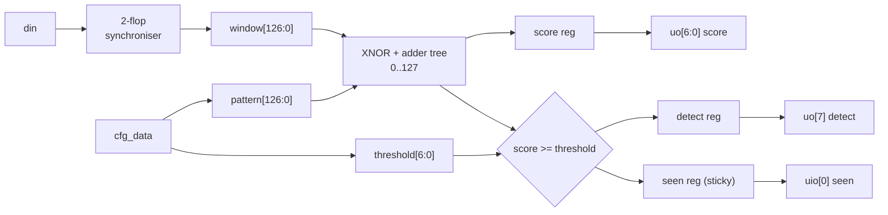

   

# 1bit-match

A 127-bit matched filter for a bit stream, built for the Tiny Tapeout GF26d shuttle on GlobalFoundries GF180MCU.

On every clock it compares the last 127 input bits with a programmable pattern and outputs how many positions match, from 0 to 127. When the score reaches a programmable threshold it raises `detect`. The input is already a bit stream, so there is no analog front end or baseband conversion.

This is a learning project. I'm using it to find out what taping out a design involves and where the limits are, so simple choices win over features. The datasheet, [docs/info.md](docs/info.md), has the full pin description and a demo-board walkthrough.

## How it works



The window, pattern and threshold are all left-shift registers on the project clock. The window shifts in `din` on every clock. `cfg_mode` and `cfg_sel` pick which of the pattern or threshold shifts in `cfg_data`. Because the window and pattern shift the same way, you load the pattern in the same order you expect it on `din`.

| Pin | Signal |
|---|---|
| `ui[0]` | `din`, the stream |
| `ui[1]` | `cfg_data` |
| `ui[2]` | `cfg_mode`, 1 = configure |
| `ui[3]` | `cfg_sel`, 0 = pattern, 1 = threshold |
| `uo[6:0]` | `score` |
| `uo[7]` | `detect`, or the readback bit in config mode |
| `uio[0]` | `seen`, a sticky `detect` |

## Results

From a local hardening run with LibreLane 3.0.14 and the gf180mcuD PDK, the same versions the `tt-gds-action@ttgf26d` workflow uses.

| | |
|---|---|
| Tiles | 1x1 |
| Clock | 10 MHz (`CLOCK_PERIOD` 100 ns) |
| Cell area | 41,450 µm² |
| Utilisation | 87.4 % |
| Worst setup slack | +36.8 ns (slow corner, 125 °C) |
| Worst hold slack | +0.15 ns |
| Flops | 272 |

## Design notes

Fitting in one tile drove most of the decisions. In GF180 a flop is about 64 µm², so the 272 flops alone take 17,300 µm², a third of the 52,000 µm² core.

**No reset on the window and pattern.** GF180 has no flop with a built-in synchronous reset, so every reset costs an extra gate per flop. With reset on all 254 window and pattern flops the design needed 45,000 µm² and placement failed. Removing it saved 3,800 µm². The cost is that the pattern is random at power-up and must be loaded before use.

**Adder tree, not a loop.** A plain `for` loop that adds 127 bits makes a chain of 127 adders. The generate loop in `src/project.v` builds a balanced tree instead, which is smaller and much faster.

**10 MHz clock.** At the default 50 MHz the popcount missed timing by about 10 ns. At 25 MHz it passed at room temperature but not at 125 °C. 10 MHz passes every corner with a lot of margin, and the demo board does not need more.

**One score per clock, not a serial correlator.** A serial count would be smaller, but bits could then arrive only once every 128 clocks. The parallel version fits, so I kept it.

**Ideas from an FPGA design.** The input synchroniser, the sticky `seen` output and the config readback come from an FPGA wakeup detector I worked on. Some of its other habits, such as clock enables and default register values, cost nothing on an FPGA but a gate per flop on an ASIC, so I left them out.

## Repository layout

| Path | Contents |
|---|---|
| `src/project.v` | The design |
| `src/config.json` | LibreLane settings, including `CLOCK_PERIOD` |
| `info.yaml` | Tiny Tapeout metadata: top module, tiles, clock, pinout |
| `docs/info.md` | Datasheet |
| `test/test.py` | cocotb tests and the reference model |
| `test/tb.v` | Verilog testbench wrapper |

## Running the tests

The tests use cocotb 2.1 with Icarus Verilog. A Python model keeps its own window, pattern and threshold, and every test checks `score`, `uo[7]` and `seen` against it on every clock. The model also tracks which registers are still unknown after power-up, so it doesn't check outputs that depend on them.

cocotb 2.1 does not build on Python 3.15, so use 3.12:

```sh
cd test
uv venv --python 3.12 .venv
uv pip install --python .venv/bin/python -r requirements.txt
PATH=$PWD/.venv/bin:$PATH make -B
```

## Hardening locally

This follows the [local hardening guide](https://www.tinytapeout.com/guides/local-hardening/), with LibreLane running in Docker. It assumes the gf180mcu PDK is installed under `~/ttsetup/pdk` and a Python environment with `tt-support-tools` requirements and `librelane==3.0.14` is on your `PATH`.

```sh
git clone https://github.com/TinyTapeout/tt-support-tools tt
export PDK_ROOT=~/ttsetup/pdk PDK=gf180mcuD
./tt/tt_tool.py --create-user-config --pdk gf180mcuD
./tt/tt_tool.py --harden --pdk gf180mcuD
./tt/tt_tool.py --print-stats --pdk gf180mcuD
```

The GDS ends up in `runs/wokwi/final/gds/`. To run the tests on the gate-level netlist:

```sh
cp runs/wokwi/final/pnl/tt_um_notthetup_1bit_match.pnl.v test/gate_level_netlist.v
cd test
make -B GATES=yes PDK_ROOT=~/ttsetup/pdk/ciel/gf180mcu/versions/<version>
```

## Tiny Tapeout resources

- [FAQ](https://tinytapeout.com/faq/)
- [Demo board guide](https://tinytapeout.com/guides/get-started-demoboard/)
- [Digital design lessons](https://tinytapeout.com/digital_design/)
- [Enabling GitHub Pages for the results page](https://tinytapeout.com/faq/#my-github-action-is-failing-on-the-pages-part)
- [Community Discord](https://tinytapeout.com/discord)
